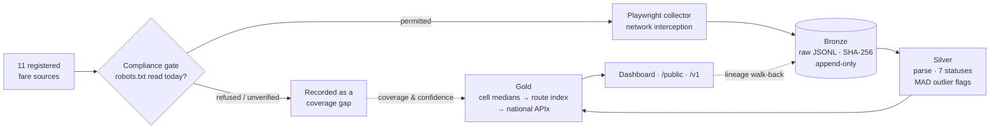

<p align="center">
  
</p>

<h1 align="center">APIx</h1>

<p align="center">
  <b>A daily, route-level airfare price index for India.</b><br>
  30 fares a day instead of one number a month, every value traceable to the bytes it came from.
</p>

<p align="center">
  
  
  
  
  
  
  <a href="LICENSE"></a>
</p>

<p align="center">
  <a href="https://vercel.com/new/clone?repository-url=https%3A%2F%2Fgithub.com%2Fmayankmalik263%2Fapix-airfare-index&env=APIX_SECRET,APIX_ADMIN_EMAIL,APIX_ADMIN_PASSWORD&envDescription=Signing%20secret%20and%20the%20operator%20account%20for%20%2Fconsole&envLink=https%3A%2F%2Fgithub.com%2Fmayankmalik263%2Fapix-airfare-index%2Fblob%2Fmain%2FVERCEL.md">
    
  </a>
</p>

<p align="center">
  <a href="#-why-it-exists">Why</a> ·
  <a href="#-the-booking-curve">Findings</a> ·
  <a href="#%EF%B8%8F-how-it-works">How it works</a> ·
  <a href="#-quick-start">Quick start</a> ·
  <a href="#-api">API</a> ·
  <a href="#-deploy">Deploy</a> ·
  <a href="#-limitations">Limitations</a>
</p>

---

## 🧭 Why it exists

India's Consumer Price Index tracks domestic air travel as **one national number,
published once a month** (item *"Air fare [normal]: economy class [adult]"*,
basket weight 0.08).

An airline seat doesn't behave like a bag of rice. The same seat can cost ₹6,000
one day and ₹24,000 the next, depending on the route, the weekday and, above all,
how far ahead you book. A monthly national average can't see any of that.

**APIx measures it daily:**

- 📅 **30 observations a day:** 6 routes × 5 booking windows, at a fixed 20:00 IST slot.
- ⚖️ **Standard index maths:** cell medians, Jevons (geometric) within a route, a
  weighted arithmetic mean across routes. The same structure official CPIs use.
- 🔍 **Fully auditable:** every published value walks back to the raw response it
  was parsed from, with its SHA-256.
- 🛡️ **Polite by design:** a compliance gate reads `robots.txt` before any browser
  starts. No CAPTCHA solving, no IP rotation, no bypassing.

> [!NOTE]
> APIx measures, it doesn't predict. There's no machine learning in the index:
> every figure has to be explainable by hand, and one test recomputes the
> published index outside the engine to prove it.

---

## 📈 The booking curve

Fares are supposed to get cheaper the earlier you book. Ours didn't.

Median fare across all six routes, at each booking window, on 2026-09-08:

```
   14.8k |     *
         |      .
         |       .
   13.5k |        ..
         |          .
         |           .
   12.1k |            .
         |             .                                          .*
         |              ..                                      ..
   10.8k |                .                                   ..
         |                 .       ......*..                ..
         |                  *......         ....          ..
    9.5k |                                      ....    ..
    9.0k |                                          ..*.
         +------------------------------------------------------------
           T+1          T+7          T+14         T+21         T+45
```

- **T+1 costs the most:** ₹14,781, a 63.4% premium over the cheapest window.
- **T+21 is the floor:** ₹9,043, the same three-week window the official CPI uses
  for domestic airfare collection.
- **Booking earlier costs more again:** ₹11,595 at T+45, up 28.2% from the floor,
  on 5 of the 6 routes.

Airlines hold inventory back in long-range fare buckets, so the cheapest moment
sits in the middle rather than as early as possible. A monthly average flattens
that shape completely.

<details>
<summary><b>Route by route, 2026-09-08</b></summary>

| Route | T+1 | T+7 | T+14 | T+21 | T+45 | T+45 vs T+21 |
|:---|---:|---:|---:|---:|---:|:---|
| **BLR-HYD** | ₹17,511 | ₹6,282 | **₹5,673** | ₹5,913 | ₹6,543 | rebounds +10.7% |
| **BOM-BLR** | ₹15,727 | ₹10,825 | ₹8,646 | **₹7,967** | ₹9,364 | rebounds +17.5% |
| **DEL-BLR** | ₹14,210 | ₹14,180 | ₹12,939 | **₹12,041** | ₹13,826 | rebounds +14.8% |
| **DEL-BOM** | ₹14,630 | **₹7,730** | ₹8,362 | ₹9,164 | ₹8,666 | keeps falling (-5.4%) |
| **DEL-CCU** | ₹12,435 | ₹9,392 | ₹13,278 | **₹8,922** | ₹18,057 | rebounds +102.4% |
| **MAA-DEL** | ₹14,932 | ₹12,976 | **₹12,520** | ₹12,520 | ₹16,177 | rebounds +29.2% |
| **All six, median** | ₹14,781 | ₹10,108 | ₹10,583 | **₹9,043** | ₹11,595 | rebounds +28.2% |

Cheapest window per route in bold. Every figure is a `gold_cell_median` value,
and each one can be walked back to its stored payload from the dashboard.

</details>

*Observed, not asserted: six routes and a few days of live collection. This is
what our data shows, not a law about airfares.*

---

## ⚙️ How it works

A medallion pipeline: raw responses are kept forever, everything downstream can
be rebuilt from them.



| Layer | What happens |
|---|---|
| **Compliance gate** | Fetches and hashes each source's `robots.txt`, stores it verbatim, and refuses any source not cleared *today*. |
| **Bronze** | The fare response exactly as received, one JSONL file per day, never modified. A fare can't be collected retrospectively, so this is the asset. |
| **Silver** | Base fare, taxes and fees split out. Every row carries one of seven statuses (`OK`, `SOLD_OUT`, `NO_SERVICE`, `SOURCE_DISALLOWED`, `FETCH_FAIL`, `BLOCKED`, `PARSE_FAIL`), with no NULLs. Outliers are flagged with MAD (\|z\| > 3.5), never deleted. |
| **Gold** | Cell medians, price relatives against the base, route and national indices, plus coverage and an A/B/C confidence grade. |

### The maths

1. **Cell median:** $P(r,w,t) = \text{median}\{\text{fares with status OK}\}$
2. **Price relative:** $R(r,w,t) = P(r,w,t) \,/\, P(r,w,0)$
3. **Route index (Jevons):** $I(r,t) = 100 \cdot \left(\prod_w R(r,w,t)\right)^{1/W}$
4. **National index:** $\text{APIx}(t) = \sum_r \omega_r \, I(r,t)$, with $\sum_r \omega_r = 1$

Medians, not means: in one DEL-BOM search the mean was around ₹8,900, a price
almost nobody paid; the median was ₹7,675. Full derivation in
[METHODOLOGY.md](METHODOLOGY.md).

### The basket

| Routes | Booking windows |
|---|---|
| DEL ⇄ BOM · DEL ⇄ BLR · BOM ⇄ BLR<br>DEL ⇄ CCU · BLR ⇄ HYD · MAA ⇄ DEL | T+1 · T+7 · T+14 · T+21 · T+45 |

Held constant: 1 adult, economy, lowest available fare. Routes and weights live in
[`config/basket.yml`](config/basket.yml): configuration, not code.

---

## 🚀 Quick start

Needs Python 3.12+.

```bash
git clone https://github.com/mayankmalik263/apix-airfare-index.git
cd apix-airfare-index
pip install -r requirements-web.txt   # serving only; use requirements.txt to collect
python -m scripts.bootstrap           # seed → Bronze → Silver → Gold, ~10 s
python -m webapp.run
```

| URL | What's there |
|---|---|
| <http://localhost:8000/> | Dashboard: index, lead-time curve, basket heatmap, data quality |
| <http://localhost:8000/docs> | Interactive OpenAPI docs |
| <http://localhost:8000/console> | Operator console (API keys, runs, access log) |

Create an operator account for the console:

```bash
python -m apix.cli useradd --email you@example.com --name "You" --generate-password
```

**Collecting live fares** needs the full requirements and a browser:

```bash
pip install -r requirements.txt && python -m playwright install chromium
python -m apix.cli compliance --check
python -m apix.cli collect --today --live
```

Run the tests with `python -m pytest tests/`.

---

## 🔌 API

Every data endpoint is mounted twice: **open** under `/public` (rate-limited, no
key) and **keyed** under `/v1` (attributable, scoped, revocable).

```bash
curl https://<your-deployment>/public/apix/latest
```

```json
{
  "available": true,
  "source_class": "LIVE",
  "observation_date": "2026-09-08",
  "apix": 94.2633,
  "change_pct": -7.8016,
  "coverage": 1.0,
  "n_expected": 30,
  "n_observed": 30,
  "confidence": "B"
}
```

```bash
curl -H "Authorization: Bearer apix_live_..." https://<your-deployment>/v1/apix/latest
```

| Endpoint | Returns |
|---|---|
| `/apix/latest` | The latest published index with coverage and confidence |
| `/apix/series?freq=daily\|weekly\|monthly` | The series at any frequency |
| `/routes/{code}/series` | One route's index over time (e.g. `DEL-BOM`) |
| `/windows/{days}/series` | One booking window across all routes |
| `/lead-time` | Median fare against booking window |
| `/composition` | Base fare vs taxes and fees |
| `/lineage/{date}/{route}/{window}` | Gold → Silver rows → Bronze payload and its SHA-256 |
| `/compliance/report` | Today's verdict per source, with the robots.txt hash |
| `/mospi` | The official monthly airfare index, for comparison |

| Tier | Path | Access |
|---|---|---|
| Public | `/`, `/public/*` | Open, rate-limited |
| Keyed | `/v1/*` | API key with scopes `read:index`, `read:lineage`, `read:compliance` |
| Operator | `/console` | Signed session. scrypt passwords, lockout after 5 failures |

API keys are 256 random bits, shown once and stored only as a SHA-256 hash.

---

## ☁️ Deploy

**Vercel**: click the button at the top, or import the repo. It's detected as
FastAPI, the build rebuilds the database from `data/seed` in about ten seconds, and
the whole app runs as one function. Set `APIX_SECRET`, `APIX_ADMIN_EMAIL` and
`APIX_ADMIN_PASSWORD`. Details and caveats: [VERCEL.md](VERCEL.md).

**Render / Docker**: [`render.yaml`](render.yaml) and the [`Dockerfile`](Dockerfile)
are included. See [DEPLOY.md](DEPLOY.md).

**Daily collection** runs from GitHub Actions
([`.github/workflows/collect.yml`](.github/workflows/collect.yml)): compliance check,
30 cells, commit the raw file, redeploy. Its schedule is off by default; run it from
the Actions tab or uncomment the cron.

---

## 📁 Project layout

```
apix/                 measurement pipeline
├─ collect/           compliance gate, collectors, Bronze archive
├─ load/              Bronze → Silver parser, outlier flags
├─ index/             Gold: the index engine
└─ cli.py             one CLI for everything
webapp/
├─ backend/           FastAPI app, auth, API keys, scheduler
└─ frontend/          dashboard + console (no build step, ECharts vendored)
config/basket.yml     routes, windows, weights
compliance/           source registry, daily verdicts, stored robots.txt files
data/seed/            the live collection days, gzipped
db/                   SQLite schema (and a PostgreSQL target schema)
scripts/              bootstrap, Vercel build, dry run
tests/                index maths, lineage, web tiers, parser resilience
```

---

## ⚠️ Limitations

Stated up front:

1. **Little live history.** Real collection covers 3, 4 and 8 September 2026. The
   ~90 days before that are generated by a deterministic replay model, labelled
   `SIMULATED` everywhere and drawn dashed, never mixed into live figures.
2. **Provisional weights.** All six routes are weighted equally until city-pair
   passenger volumes are loaded, and every affected row says so
   (`weights_provisional = true`).
3. **Partial source coverage.** Of 11 registered sources, 5–6 clear the compliance
   gate on a given day. The rest are reported as unobserved, not worked around.
4. **Datacenter collection.** Runs from GitHub Actions on 10–13 September recorded
   0 priced fares. Those days are published as empty with coverage 0, not filled in.

More in [METHODOLOGY.md](METHODOLOGY.md) and [GUIDE.md](GUIDE.md).

---

## 📄 License

[MIT](LICENSE). The vendored ECharts (Apache-2.0) and fonts (SIL OFL) keep
their own licenses.

---

<p align="center">
  <br>
  <sub>Built with medians, not means.</sub>
</p>
